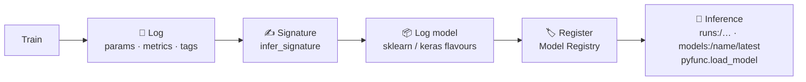

<div align="center">

# 🧪 MLflow Lab

### Experiment tracking, hyperparameter tuning and a model registry, from scikit-learn to Keras

*Three hands-on projects that show MLflow's full lifecycle. The real `mlruns/` from each experiment are committed, so you can browse them.*

<br/>


</div>

---

## 🧭 What's inside

| # | Project | Dataset | Shows | Best result |
|---|---|---|---|---|
| 0 | [`get-started.ipynb`](get-started.ipynb) | none | Connecting to a local tracking server and logging metrics | none |
| 1a | [`1-ML_Project/gettingstarted.ipynb`](1-ML_Project/gettingstarted.ipynb) | Iris | Params, metrics, tags, **signatures**, `pyfunc` loading, **Model Registry** | accuracy **1.00** |
| 1b | [`1-ML_Project/housepricepredict.ipynb`](1-ML_Project/housepricepredict.ipynb) | California Housing | **GridSearchCV** Random Forest tuning, logged and **registered** as `Best_Random_Forest` | MSE **0.230** |
| 2 | [`2-DL-Project/starter.ipynb`](2-DL-Project/starter.ipynb) | Wine Quality (white) | **Hyperopt TPE** over a Keras ANN with **nested runs** | RMSE **0.743** |

---

## 🔁 The MLflow lifecycle covered



---

## 1️⃣ Classical ML: Iris and California Housing

- **Iris logistic regression.** Logs several runs with different solvers into the `MLFLOW Quickstart` experiment, then registers the model as `tracking-quickstart`. It is loaded back with **`mlflow.pyfunc`** and through the registry URI **`models:/tracking-quickstart/latest`**.
- **California Housing.** A `RandomForestRegressor` is tuned with **GridSearchCV** (3-fold) over `n_estimators`, `max_depth`, `min_samples_split` and `min_samples_leaf`. The best parameters (`n_estimators=100`, `min_samples_leaf=2`) and the test MSE are logged, and the model is registered as **`Best_Random_Forest`**.

## 2️⃣ Deep learning: Wine Quality with Hyperopt

- A Keras ANN with a **normalisation layer fitted on training statistics** predicts wine quality.
- **Hyperopt TPE** searches learning rate (log-uniform 1e-5 to 1e-1) and SGD momentum (uniform 0 to 1).
- Every trial is a **nested child run** under one parent, so the comparison stays readable in the MLflow UI.

| Trial | Learning rate | Momentum | Eval RMSE |
|---|---:|---:|---:|
| **best** ✅ | **0.0065** | **0.500** | **0.743** |
| | 0.0021 | 0.179 | 1.038 |
| | 0.00073 | 0.012 | 1.309 |
| | 0.000011 | 0.124 | 5.199 |

Very small learning rates barely train in the 3-epoch budget. TPE moves quickly toward the useful range around 5e-3.

---

## 🚀 Run it

```bash
git clone https://github.com/nishantrv/MLFlow-ML-DL-Projects.git
cd MLFlow-ML-DL-Projects
pip install -r requirements.txt
mlflow ui                     # tracking server → http://127.0.0.1:5000
# then open any notebook and run all cells
```

The committed `mlruns/` and `mlartifacts/` folders mean `mlflow ui` shows the original experiments straight away.

---

<div align="center">

Built by **[Nishant](https://github.com/nishantrv)**. If this was useful, a ⭐ is appreciated.

</div>
